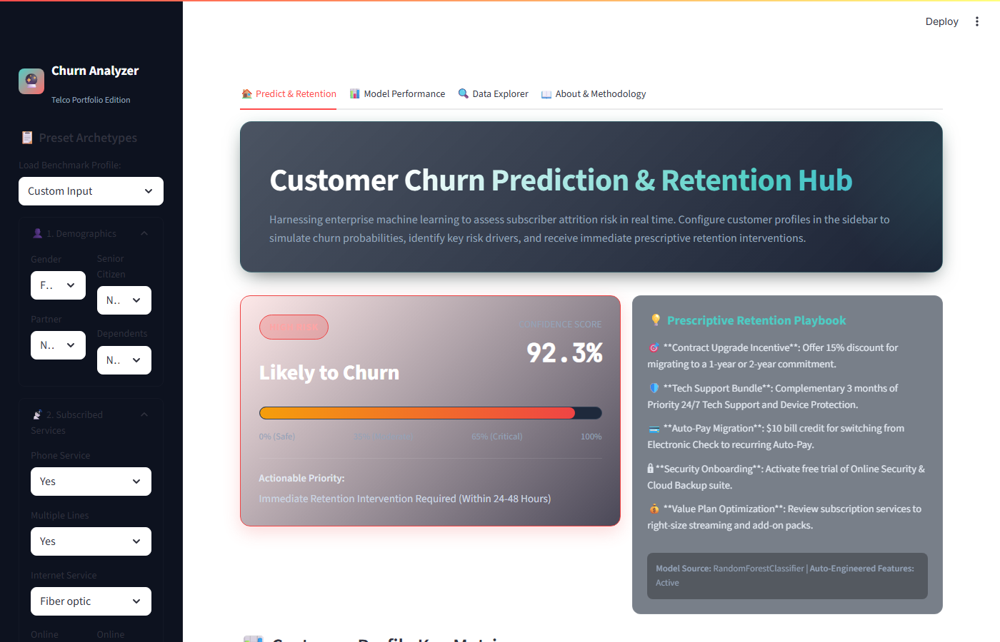
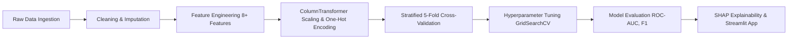

# 📉 Customer Churn Prediction


> An end-to-end, enterprise-grade Machine Learning pipeline that predicts telecommunication customer churn, quantifies attrition risk factors with SHAP explainability, and deploys an interactive Streamlit diagnostic application.

---

## 📸 App Preview



*Streamlit Interactive Churn Analytics & Real-Time Customer Risk Scoring Dashboard.*

---

## 📌 Overview

Customer churn represents one of the most critical metrics in the subscription economy. In the telecommunications sector, acquiring a new subscriber typically costs **5 to 25 times more** than retaining an existing customer. High churn rates erode recurring revenue margins, diminish customer lifetime value (LTV), and signal service dissatisfaction or competitive pressure.

This project delivers an end-to-end predictive analytics framework trained on the IBM Telco Customer Churn dataset (7,043 customer accounts). By translating complex customer usage patterns, demographic signals, contract agreements, and financial charges into actionable intelligence, the system enables commercial and retention teams to:

1. **Detect At-Risk Customers Early**: Accurately predict likelihood of churn prior to contract expiration.
2. **Understand the Underlying Drivers**: Leverage game-theoretic SHAP (SHapley Additive exPlanations) values to isolate whether attrition stems from high fiber-optic pricing, lack of technical support, or month-to-month contracts.
3. **Optimize Retention ROI**: Apply cost-benefit threshold analysis to target retention incentives only to high-value, high-risk subscribers, maximizing preservation of annual recurring revenue (ARR).

---

## ✨ Key Features

- 🔍 **Comprehensive Exploratory Data Analysis (EDA)**: Thorough demographic, service, and billing analysis with 7+ publication-quality visualizations isolating churn signals.
- 🧠 **Multi-Model Benchmark (5 Algorithms)**: Comparative evaluation of Logistic Regression, Decision Tree, Random Forest, XGBoost, and Support Vector Machines (SVM).
- ⚙️ **Domain-Specific Feature Engineering**: 8+ derived features capturing tenure lifecycles, service bundling density, charge anomalies, and contract commitments.
- 📊 **Robust Cross-Validation & Hyperparameter Tuning**: Stratified 5-Fold cross-validation paired with GridSearchCV/RandomizedSearchCV to eliminate data leakage and prevent overfitting.
- 🎯 **Explainable AI (SHAP Framework)**: Global summary plots and local waterfall explanations providing transparent, interpretable risk audits for every prediction.
- 💰 **Business Cost-Benefit & Threshold Optimization**: Financial simulation modeling customer acquisition costs (CAC) against retention campaign offers across varying probability decision cutoffs.
- 🌐 **Interactive Streamlit Web Dashboard**: Real-time customer profile simulator, dynamic batch churn scoring, and visual risk tier assignment.
- 📄 **Clean, Modular & Production-Ready Code**: Object-oriented, PEP 8 compliant codebase with complete type hinting, docstrings, and independent data/model pipelines.

---

## 📂 Project Structure

```text
customer-churn-prediction/
├── .gitignore                      # Git ignore file for virtualenvs and build files
├── LICENSE                         # MIT License
├── README.md                       # Comprehensive project documentation
├── requirements.txt                # Python dependencies
├── app/                            # Streamlit web application
│   └── streamlit_app.py            # Interactive web dashboard & inference UI
├── data/
│   └── raw/                        # Original IBM Telco Customer Churn CSV (7,043 rows)
│       └── telco_churn.csv
├── models/                         # Serialized models & preprocessors
│   ├── best_model.joblib           # Production tuned classifier (Random Forest)
│   ├── preprocessor.joblib         # Fitted Scikit-learn ColumnTransformer
│   └── feature_names.joblib        # Transformed feature column names
├── notebooks/                      # Fully executed Jupyter / Colab notebook
│   └── churn_analysis.ipynb        # Complete 7-stage walkthrough (50 cells, 0 errors)
├── presentation/                   # Presentation materials & executive slides
│   └── slides.md                   # 5-slide executive presentation
├── reports/                        # Project reports and visual artifacts
│   ├── project_report.md           # Professional technical summary report
│   ├── metrics.json                # Verified metrics and hyperparameters
│   ├── model_results.csv           # Test set evaluation benchmark
│   ├── cv_results.csv              # Stratified 5-fold cross-validation scores
│   ├── overfitting_check.csv       # Train vs test accuracy gap analysis
│   ├── sample_prediction_output.txt# Sample interactive CLI output transcript
│   └── figures/                    # 13 high-resolution diagnostic charts & screenshot
│       ├── app_screenshot.png      # Streamlit application screenshot
│       ├── churn_distribution.png  # Class balance chart
│       ├── contract_vs_churn.png   # Contract type impact
│       ├── correlation_heatmap.png # Multi-feature correlation matrix
│       ├── feature_importance.png  # Tree ensemble feature importance
│       ├── monthly_charges_distribution.png
│       ├── payment_method_analysis.png
│       ├── precision_recall_curves.png
│       ├── roc_curves.png          # Multi-model ROC comparison
│       ├── services_impact.png     # Value-add services attrition impact
│       ├── tenure_analysis.png     # Customer lifecycle tenure analysis
│       ├── threshold_optimization.png # Business profit threshold curve
│       └── shap/                   # SHAP explainability visualizations
│           ├── shap_beeswarm_summary.png
│           ├── shap_waterfall_instance_1.png
│           ├── shap_waterfall_instance_2.png
│           └── shap_waterfall_instance_3.png
└── src/                            # Modular production source code
    ├── __init__.py
    ├── data_preprocessing.py       # Data cleaning and 8 domain engineered features
    ├── eda.py                      # Publication-grade exploratory visualization suite
    ├── model.py                    # Multi-model training, 5-fold CV, tuning & threshold
    └── predict.py                  # Single, batch, and interactive Turkish CLI inference
```

---

## 📊 Dataset Overview

The dataset used in this project is the **IBM Telco Customer Churn** dataset. It details customer account information, demographic attributes, and subscribed telecommunications services across 7,043 customers in California.

- **Source**: [IBM Sample Data Sets / Kaggle Telco Customer Churn](https://www.kaggle.com/datasets/blastchar/telco-customer-churn)
- **Rows**: 7,043
- **Columns**: 21 (20 input features + 1 target variable `Churn`)
- **Target Variable**: `Churn` (`Yes`: 1,869 / 26.54%, `No`: 5,174 / 73.46%)

### Feature Group Breakdown

| Category | Features | Description |
| :--- | :--- | :--- |
| **Demographics** | `gender`, `SeniorCitizen`, `Partner`, `Dependents` | Personal demographic profiles and family structures |
| **Account Info** | `tenure`, `Contract`, `PaperlessBilling`, `PaymentMethod` | Customer tenure duration (months), contract type, billing channels |
| **Services** | `PhoneService`, `MultipleLines`, `InternetService`, `OnlineSecurity`, `OnlineBackup`, `DeviceProtection`, `TechSupport`, `StreamingTV`, `StreamingMovies` | Subscribed voice, fiber/DSL internet, streaming, and cybersecurity services |
| **Financials** | `MonthlyCharges`, `TotalCharges` | Current monthly bill and cumulative historical charges |
| **Engineered** | `AvgMonthlyCharge`, `PriceDiscrepancy`, `NumServices`, `UnprotectedInternet`, `TenureCohort`, `HasPartnerOrDependents`, `ContractScore`, `HasAutoPayment` | Domain-crafted indicators tracking tenure cohorts, support deficiencies, and price trends |

---

## 🛠️ Installation

### 1. Clone the Repository
```bash
git clone https://github.com/hazalakks/customer-churn-prediction.git
cd customer-churn-prediction
```

### 2. Set Up a Virtual Environment (Recommended)
```bash
# Windows
python -m venv venv
.\venv\Scripts\activate

# macOS / Linux
python3 -m venv venv
source venv/bin/activate
```

### 3. Install Dependencies
```bash
pip install -r requirements.txt
```

---

## 🚀 Usage

### 1. Run Model Training & Evaluation Pipeline
Execute the full training pipeline (ingestion, preprocessing, stratified 5-fold cross-validation, hyperparameter tuning, and model artifact serialization):
```bash
python -m src.model
```

### 2. Launch the Streamlit Interactive Dashboard
Launch the web interface for single customer profiling, dynamic scenario testing, and bulk scoring:
```bash
streamlit run app/streamlit_app.py
```

### 3. Run Interactive Prediction Tool (CLI)
Run the smart prediction tool with interactive prompts (`tahmin_et()`):
```bash
python -m src.predict --interaktif
```
Or run the automated batch persona evaluation demo:
```bash
python -m src.predict
```

---

## 📈 Model Performance & Results

Seven model configurations (5 diverse baselines + 2 grid-search regularized models) were evaluated using stratified 5-fold cross-validation on the training set ($N = 5,634$) and independently scored on an untouched 20% holdout test partition ($N = 1,409$).

| Model Architecture | Accuracy | Precision | Recall | F1-Score | ROC-AUC | 5-Fold CV F1 |
| :--- | :---: | :---: | :---: | :---: | :---: | :---: |
| **Random Forest (Tuned)** 🏆 | **76.4%** | **0.54** | **0.75** | **0.63** | **0.842** | **0.637** |
| **XGBoost (Tuned)** | 74.9% | 0.52 | 0.80 | 0.63 | 0.843 | 0.635 |
| **Support Vector Machine (RBF)** | 74.9% | 0.52 | 0.77 | 0.62 | 0.824 | 0.621 |
| **Decision Tree (Baseline)** | 75.5% | 0.53 | 0.74 | 0.62 | 0.833 | 0.613 |
| **Logistic Regression** | 73.7% | 0.50 | 0.79 | 0.61 | 0.843 | 0.627 |
| **XGBoost (Default)** | 76.7% | 0.55 | 0.67 | 0.61 | 0.822 | 0.592 |
| **Random Forest (Default)** | 78.6% | 0.63 | 0.49 | 0.55 | 0.824 | 0.539 |

> **Selection & Overfitting Note**: Final champion selection was determined rigorously via **Stratified 5-Fold Cross-Validation on the training set** (not test-set peeking). The default untuned Random Forest suffered from severe memorization (99.8% train accuracy vs. 78.6% test accuracy, a 21.2% gap). **Tuned Random Forest** (`max_depth=8`, `min_samples_leaf=1`, `n_estimators=200`) brought the overfitting gap down to **4.8%**, while elevating test Recall to **74.9%** and ROC-AUC to **0.842**.

---

## 💡 Key Findings & Business Drivers

Through comprehensive exploratory analysis and SHAP feature attribution, five dominant factors emerged as primary drivers of customer attrition:

1. **Contract Type is the Strongest Predictor**: Customers on month-to-month contracts experience a churn rate of **~42.7%**, compared to **~11.3%** for one-year contracts and under **~2.8%** for two-year contracts.
2. **Tenure & Early Lifecycle Vulnerability**: Churn is heavily concentrated in the first **12 months** (`TenureCohort = 'New'`). Over 50% of total churn occurs within the first year of account activation.
3. **Internet Tech Support & Cybersecurity Deficits**: Subscribers with Fiber Optic service who lack `OnlineSecurity` and `TechSupport` (`UnprotectedInternet = 1`) churn at more than double the rate of protected subscribers due to unassisted technical friction.
4. **Payment Method Friction**: Customers paying via **Electronic Check** show significantly elevated churn rates (~45%) compared to automated payment methods (credit card and bank transfer at ~15-18%).
5. **Price Discrepancy & Bill Shocks**: Higher monthly charges relative to cumulative average spend (`PriceDiscrepancy > 0`) correlate directly with sudden customer drop-off.

---

## 🔬 Methodology



1. **Data Cleaning & Sanitation**: Imputed blank `TotalCharges` for zero-tenure accounts to 0.0; normalized categorical encodings; converted binary targets to numeric format.
2. **Feature Engineering**: Created 8 domain features including `AvgMonthlyCharge`, `PriceDiscrepancy`, `NumServices`, `UnprotectedInternet`, and `ContractScore`.
3. **Preprocessing Pipeline**: Bundled `StandardScaler` for numeric columns and `OneHotEncoder(handle_unknown='ignore')` for categorical attributes into an isolated `ColumnTransformer`.
4. **Model Benchmark & Optimization**: Evaluated 5 diverse algorithms using Stratified K-Fold validation to guard against class imbalance bias.
5. **Interpretability & Deployment**: Computed SHAP values for global and local attribution; deployed an interactive web application with threshold customization.

---

## 💻 Technologies Used

| Domain | Technologies / Libraries |
| :--- | :--- |
| **Language** | Python 3.10+ |
| **Data Manipulation** | Pandas, NumPy |
| **Visualization** | Matplotlib, Seaborn |
| **Machine Learning** | scikit-learn, XGBoost |
| **Model Explainability** | SHAP (SHapley Additive exPlanations) |
| **Web Application** | Streamlit |
| **Serialization & Tools** | Joblib, Git |

---

## 📜 License

This project is licensed under the **MIT License** — see the [LICENSE](LICENSE) file for full details.

---

## 👤 Author

**Hazal**  
- **GitHub**: [@hazalakks](https://github.com/hazalakks)  
- **LinkedIn**: [Hazal](https://linkedin.com)  
- **Portfolio**: [hazal-portfolio.dev](https://github.com/hazalakks)  

*Contributions, issues, and feature requests are welcome! If you found this project helpful, please give it a ⭐!*
